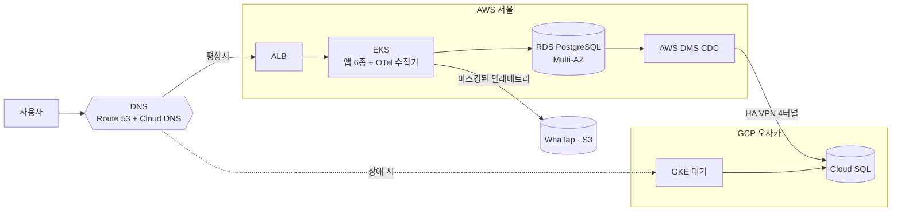

## 프로젝트 요약

| 항목 | 내용 |
|---|---|
| 목적 | 은행 마이크로서비스를 AWS 주 사이트와 GCP 대기 사이트에 걸쳐 운영하고, 클라우드 단위 장애에 대비한 재해복구를 구축·시연 |
| 대상 | 구글 샘플 은행 앱 Bank of Anthos (Python 3종, Java 3종), PostgreSQL 2개 DB |
| 담당 파트 | Database(DR), Observability, Governance |

**핵심 기여**

- **설계** — 두 클라우드의 제약에서 DR 방식(Active-Standby, 비동기 CDC)과 복제 도구(AWS DMS)를 정하고, Terraform 컴포넌트 루트 · GCP 대기 사이트 · AWS↔GCP VPN으로 구현했습니다.
- **모니터링** — 앱을 고치지 않는 관측 스택을 두 클라우드에 같은 구성으로 배포했습니다. 외부로 나가는 금융 데이터는 한 지점에서 마스킹했습니다.
- **감사** — CloudTrail 트레일, 객체 잠금 감사 버킷, EKS audit 로그를 엮어 변경 행위자를 추적하는 감사 체인을 구성했습니다.

## 문제와 제약

**풀어야 했던 문제.** 한 클라우드 전체가 장애를 일으켜도 서비스가 이어져야 했고, 그때 잃는 데이터가 얼마인지 설명할 수 있어야 했습니다.

**단순하게 풀 수 없었던 이유**

- **실패 도메인이 두 개뿐입니다.** 두 곳이 동시에 쓰기를 받으려면 합의(쿼럼)가 필요한데, 쿼럼은 독립된 장애 단위가 최소 3개 있어야 성립합니다. 그래서 비동기 복제를 받아들이고 그 지연을 감시하는 쪽을 택했습니다.
- **두 클라우드의 DB 네트워크가 비대칭입니다.** RDS는 우리 서브넷 안에 있지만, Cloud SQL은 구글이 관리하는 별도 VPC에 피어링으로 붙습니다. VPN 너머에서 닿으려면 피어링에 경로를 따로 내보내야 했습니다.
- **은행 데이터가 외부 SaaS로 나갑니다.** 관측 데이터에 계좌번호가 섞이면, 한 번 보낸 뒤에는 회수할 수 없습니다.
- **기간이 5주**였습니다. Active-Active 대신 Active-Standby를 먼저 완결하기로 했습니다.

**판단 기준** — "건너갔다가 돌아올 수 있는가", "앱 코드를 고치지 않는가", "민감정보가 나가는 출구가 하나인가"

## 전체 구조

| 구성 요소 | 역할 | 내 기여 |
|---|---|---|
| Terraform 루트 (AWS 8 · GCP 4 · VPN 1) | 양 클라우드 인프라 선언 | 구조 설계, GCP · VPN · DMS 루트 작성 |
| EKS / GKE + Argo CD | 같은 매니페스트로 양쪽에 앱 배포 | 관측 Application과 권한 경계 |
| RDS → DMS → VPN → Cloud SQL | 단방향 연속 복제 | 도구 선정, 복제 설정, 슬롯 · 지연 감시 |
| OpenTelemetry 수집기 | 앱 무수정 계측, 마스킹, 목적지 분기 | 설계 · 배포 · 마스킹 규칙 |
| CloudTrail · 감사 버킷 · EKS audit | 변경 행위자 추적 | 트레일 · 버킷 구성, 감사 체인 분석 |

## 핵심 기여와 기술적 의사결정

### 되돌아올 수 있는 복제 도구를 고르다

- **문제** — AWS DMS와 GCP DMS 중 무엇으로 RDS를 Cloud SQL에 복제할지 정해야 했습니다.
- **판단** — GCP DMS는 서비스 요금이 없고 스키마도 더 온전히 옮기지만, 전환(승격)이 비가역이라 GCP에서 AWS로 돌아오는 경로가 도구 안에 없습니다. 재해복구는 왕복이 전제이고 시연도 반복해야 했기 때문에, Cloud SQL을 소스로도 지원하는 **AWS DMS**를 택했습니다.
- **구현** — RDS 파라미터 그룹에 논리 복제를 켜고, DMS 복제 인스턴스 · 엔드포인트 · 태스크를 Terraform 루트로 작성했습니다.
- **남은 제약** — 대기 DB가 늘 쓰기 가능해 실수로 쓸 수 있고, DMS는 시퀀스를 복제하지 않아 전환 때 시퀀스 보정이 필수입니다.

### Terraform을 컴포넌트 루트로 나누다

- **문제** — 하나의 루트에 VPC · EKS · RDS · 캐시가 모두 묶여 plan 범위가 크고 state 잠금이 전원에게 걸렸습니다.
- **판단** — 루트를 컴포넌트별로 나누고 서로 직접 참조하지 않게 했습니다. 예를 들어 RDS 인바운드를 EKS 보안그룹이 아니라 프라이빗 서브넷 대역으로 허용해, DB 루트가 클러스터 루트를 몰라도 되게 했습니다.
- **구현** — 설계 문서와 단계별 구현 계획을 먼저 쓰고, 모듈 이동 → 보안 모듈 해체 → IAM 분리 → 루트 생성 → 기존 루트 제거 순으로 리팩터했습니다. 이어 GCP 미러 루트와 VPN 루트를 추가했습니다.

### 앱을 고치지 않는 관측, 출구가 하나인 마스킹

- **판단** — 앱 · 클러스터 계층을 모두 OpenTelemetry로 보는 안을 택했습니다. 목적지를 바꿀 때 수집기 설정만 고치면 되고, 클러스터를 나가는 데이터가 전부 수집기를 지나 **마스킹 지점이 하나**가 되기 때문입니다.
- **구현** — 파드 어노테이션 한 줄로 Java · Python 에이전트를 주입했습니다. 수집기는 역할별로 셋으로 나눴고, EKS와 GKE의 마스킹 규칙은 한 글자도 다르지 않게 맞췄습니다.
- **결과** — 앱 코드를 한 줄도 고치지 않고 이미지도 다시 빌드하지 않은 채 6개 서비스를 계측했습니다.

### 공용 관리 서버에서 "누가 바꿨나"를 답하는 감사 체인

- **문제** — 팀이 관리 서버 한 대를 공용 계정으로 함께 썼고, 그 서버 역할이 클러스터 관리자 권한을 갖고 있었습니다.
- **판단** — 실제 로그를 열어 보니 kubectl 인증 과정에서 CloudTrail에 남는 IP는 사용자가 아니라 EKS 제어부의 IP였고, 진짜 클라이언트 IP는 audit 로그에만 있었습니다. 두 기록을 엮어 인스턴스까지 특정하는 체인으로 정리했습니다.
- **구현** — 관리 이벤트 전체와 감사 · 보관 버킷 데이터 이벤트로 트레일을 구성하고, 감사 버킷에 객체 잠금(GOVERNANCE)과 수명 주기(90일 Glacier · 365일 삭제)를 걸었습니다.
- **결과** — audit 로그에서 관리 서버로 HPA를 직접 고쳐 Argo CD 추적 표시가 지워진 기록을 찾았습니다. **GitOps를 우회한 변경을 감사로 잡아낸 사례**입니다.

## 문제 해결 사례

### 마스킹이 있다고 생각했던 곳에 없었다

- **문제** — 발표 자료에는 "앱 필드 기반 마스킹"이 적혀 있었지만 실제로는 동작하지 않았습니다. 앱은 오히려 회원가입 요청을 통째로 디버그 로그에 남기고 있었습니다.
- **원인** — 수집기 규칙에도 구멍이 세 개 있었습니다. 라우팅번호 규칙 누락, JWT 치환이 로그에만 있고 트레이스에는 없음, 값 치환이 URL 경로 하나만 봄. 값을 통째로 지우는 단계가 부분 마스킹보다 먼저 실행되는 **순서 문제**도 있었습니다.
- **변경** — 속성 맵 전체를 훑도록 바꾸고 본문용 규칙을 추가했습니다. 계좌 · 라우팅번호는 끝 6자리만 가려 조사용 단서는 남겼습니다.
- **검증** — 실제 로그 형태 4종을 재현해 규칙을 적용했고, **남은 민감값 0개**를 확인했습니다.

### 복제는 멀쩡한데 소스 디스크가 차오른다

- **문제** — 복제 지연은 0초인데, 소스 DB의 복제 슬롯이 붙잡은 변경 로그(WAL)가 **최대 9GB**까지 불어났습니다.
- **조사** — 지표를 10분 단위로 쪼개 보니 5분마다 64MB씩 늘고 있었습니다. RDS가 유휴 상태에서도 5분마다 로그 세그먼트를 전환하는데, 트래픽이 없어 슬롯이 앞으로 나아가지 못한 것입니다.
- **변경** — DMS 소스 엔드포인트에 하트비트를 켜고 주기를 5분으로 맞췄습니다.
- **결과** — 적용 약 5분 뒤 **0.1GB 미만**으로 떨어졌고 그 수준에서 유지됐습니다.

### 장애 시연을 기록으로 다시 읽다

- **문제** — 장애 주입 시연(DB 중지, 네트워크 차단) 후 GCP에서 쓰기를 받는 데까지는 갔지만, 목표(RTO · RPO)를 지켰는지 말할 근거가 없었습니다.
- **조사** — CloudTrail · CloudWatch · GCP Cloud Monitoring 기록을 시각순으로 맞춰 사건을 재구성했습니다.
- **결과** — 감지 · 전환 시점을 정리해 **RTO 목표 미달 가능성과 RPO 측정점 부재**를 도출했습니다. 페일백 중 모든 계층이 동시에 끊긴 원인은 시연 때 지운 기본 NACL 규칙으로 특정했습니다.

## 결과와 검증

| 구분 | 내용 |
|---|---|
| 구현 | AWS · GCP 양 사이트, VPN, DMS CDC, GitOps 배포, OpenTelemetry 관측, 수집기 마스킹, 복제 · 장애 알림 |
| 시연에서 확인 | 실제 데이터의 GCP 복제, 장애 주입 후 GCP에서 쓰기 처리 |
| 측정 | 슬롯 적체 최대 9GB → 0.1GB 미만, 마스킹 재현 로그 잔여 민감값 0개 |
| 미검증 | RTO · RPO 목표 달성, 부하 상태의 평상시 복제 지연, 페일백 완료 |

> 교육 과정의 시연 환경이며 실제 사용자 트래픽은 없었습니다.

## 회고

- **RPO는 설정이 아니라 측정이다.** 처음에는 "CDC라 사실상 유실이 없다"고 생각했지만, 비동기 복제의 RPO는 장애 순간의 지연입니다. 목표를 정하기 전에 감지 가능한 최소 시간과 평상시 지연부터 재야 한다고 판단을 바꿨습니다.
- **유지할 선택** — 되돌아올 수 있는 복제 도구, 마스킹 지점의 단일화, 컴포넌트 루트, Argo CD 권한 경계
- **바꿀 선택** — DMS를 코드와 콘솔 중 한쪽으로 통일, DMS와 대기 DB에 고가용성 확보, 시연 전에 측정점 정하기

> 팀 프로젝트이며, GitOps 스크립트 · CI · 오토스케일링 · DR 감지 자동화는 팀원이 구현했습니다.
> 코드 작성 일부에 AI 도구(Claude Code)를 활용했고, 문제 정의 · 설계 판단 · 검증은 직접 했습니다.
