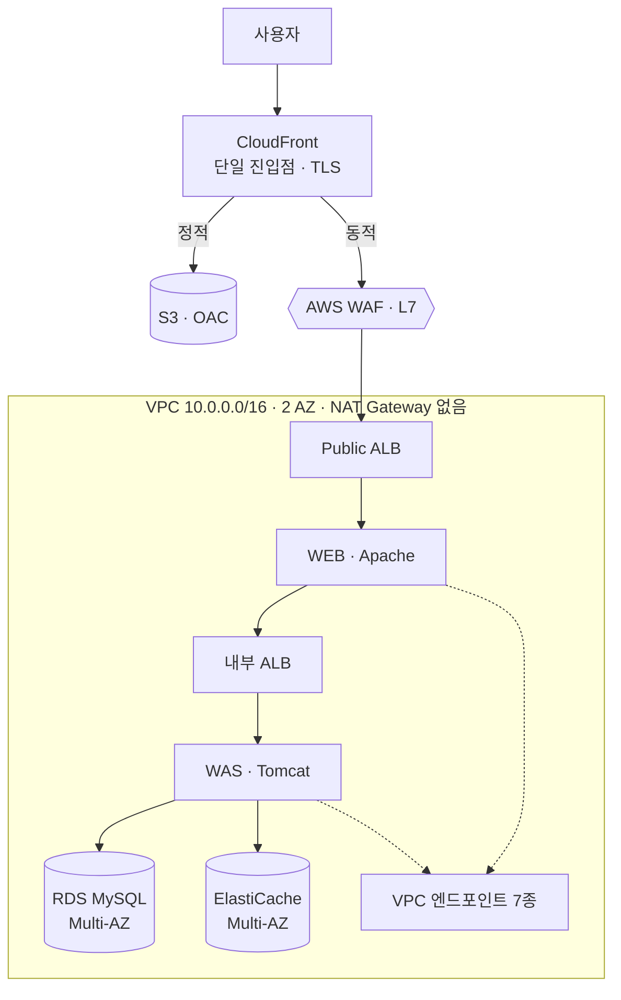

## 프로젝트 요약

| 항목 | 내용 |
|---|---|
| 무엇을 | 동물병원 관리 웹앱(Spring PetClinic)을 운영하기 위한 AWS 3-Tier 인프라 |
| 목표 | 과제 필수 요소(Apache · Tomcat · RDS MySQL · mod_proxy)를 구축하고, AWS Well-Architected 6 Pillars 기준으로 설계 결정을 점검 |
| 팀 구성 | 네트워크/보안(본인) · WEB · WAS · DB · 모니터링 |
| 구축 결과 | VPC 1 · 서브넷 16 (2 AZ) · 커스텀 NACL 8 · **NAT Gateway 0** · VPC 엔드포인트 7 · WAF 규칙 6 |

## 전체 구조

## 핵심 설계 결정

### 티어 예약형 VPC — 부족한 것은 IP가 아니라 서브넷 개수

`/16` VPC의 IP는 65,536개로 충분하지만, 서브넷은 VPC당 기본 200개가 한도입니다.
그래서 티어마다 `/21`(= `/24` 여덟 칸)을 예약하고 실제로는 AZ마다 `/24` 하나만 배포했습니다.
**NACL 규칙은 개별 서브넷이 아니라 티어 예약 대역 단위로 등록**해, 같은 티어에 서브넷을 추가해도 NACL 규칙이 바뀌지 않습니다.

| 티어 | 예약 대역 | 실제 서브넷 (2a · 2c) |
|---|---|---|
| PUBLIC | 10.0.0.0/21 | 10.0.0.0/24 · 10.0.2.0/24 |
| ELB-PUB / ELB-PRIV | 10.0.8.0/22 · 10.0.12.0/22 | 10.0.8.0/24 · 10.0.10.0/24 / 10.0.12.0/24 · 10.0.14.0/24 |
| WEB | 10.0.16.0/21 | 10.0.16.0/24 · 10.0.18.0/24 |
| WAS | 10.0.32.0/21 | 10.0.32.0/24 · 10.0.34.0/24 |
| REDIS | 10.0.48.0/21 | 10.0.48.0/24 · 10.0.50.0/24 |
| DB | 10.0.64.0/21 | 10.0.64.0/24 · 10.0.66.0/24 |
| VPC-ENDPOINT | 10.0.80.0/21 | 10.0.80.0/24 · 10.0.82.0/24 |

### NAT Gateway 없는 사설 네트워크 (Full PrivateLink)

프라이빗 라우팅 테이블에서 인터넷 경로(`0.0.0.0/0`)를 없애고, 필요한 AWS 서비스마다 엔드포인트를 두었습니다.

| 엔드포인트 | 없으면 생기는 일 |
|---|---|
| ssm · ssmmessages · ec2messages | 서버 접속(Session Manager)과 명령 전달 불가 |
| logs · monitoring | 서비스는 돌지만 로그 · 지표 · 알람이 멈춤 |
| secretsmanager | WAS 기동 시 DB 접속정보를 못 읽어 Tomcat이 뜨지 않음 → 서비스 전체 장애 |
| s3 (Gateway) | Amazon Linux 패키지 설치와 S3 업로드 불가 |

> **트레이드오프** — 실측 결과 VPC 엔드포인트가 프로젝트 비용 1위(13일간 전체의 약 38%)였습니다.
> 이 결정은 비용 절감이 아니라 **보안을 위해 비용을 지불한 선택**이고, 패키지 설치 · OS 패치 부담이 WEB/WAS 파트로 넘어갔습니다.

### Bastion 없는 접속 · 권한 설계

- SSM Session Manager로 바꿔 **관리용 인바운드 포트 0개**, SSH 키 관리도 없앴습니다.
- 접속 기록은 CloudTrail(누가 언제 어떤 인스턴스에)과 세션 로그(무엇을 실행했는지) 두 곳에 남깁니다.
- 팀원 권한은 파트별 IAM 그룹(RBAC)으로 나누고, 서버 접속은 Tier 태그로 범위를 좁히는 방식(ABAC)으로 설계했습니다.

### 다층 방어 — 보안그룹 참조 체인

| 보안그룹 | 인바운드 | 아웃바운드 |
|---|---|---|
| ELB-Pub | 0.0.0.0/0 :80, :443 | → WEB :80 |
| WEB | ← ELB-Pub :80 | → ELB-Priv :8080, VPCE :443 |
| ELB-Priv | ← WEB :8080 | → WAS :8080 |
| WAS | ← ELB-Priv :8080 | → DB :3309, Redis :6379, VPCE :443 |
| DB · Redis · VPCE | 앞 계층 보안그룹만 | 기본값 (말단) |

각 관문이 IP가 아니라 **바로 앞 계층의 보안그룹**을 기준으로 열려 있어, WEB 서버가 침해되더라도 DB 포트로 직접 연결할 수 없습니다.

### WAF — 한도 안에서 고르고, Count로 먼저 관찰

관리형 규칙을 모두 켜면 Web ACL 기본 한도(1,500 WCU)를 넘습니다. 규칙 그룹별 WCU를 조회해 앱 특성(Java · DB · Linux)에 맞게
Origin 검증(Count) · Common · SQL Injection · Known Bad Inputs · Linux · Rate 제한의 6개 규칙(1,305 WCU)으로 구성했습니다.

## 대표 문제 해결 — WAF가 사진 업로드를 막았을 때

- **문제** — WAF를 붙이자 반려동물 사진 업로드가 동작하지 않았습니다. 같은 로그에 실제 공격성 요청 차단도 섞여 있었습니다.
- **조사** — WAF 로그 24시간분을 차단 규칙별로 분류해 정상 기능 차단 · 부하테스트 · User-Agent 없는 요청 · SQL 인젝션 시도로 나눴습니다.
- **원인** — 약 80KB 업로드가 관리형 Common 규칙의 본문 크기 제한(8KB)에 걸린 **오탐**이었습니다.
- **조치** — 규칙 그룹 전체가 아니라 해당 **하위 규칙 하나만 Count로 전환**해 기능을 복구했습니다.
- **한 단계 더** — 이렇게 하면 모든 경로의 크기 제한이 함께 풀린다는 문제를 짚고, WAF 라벨을 활용해 **업로드 경로만 예외**로 두는 규칙을 설계했습니다.

그 밖의 트러블슈팅(MFA 정책 충돌, S3 게이트웨이와 NACL, Flow Logs 신뢰 정책)은 [설계 문서 저장소](https://github.com/swoobuntu/aws-3tier-network-security/blob/main/docs/03-troubleshooting.md)에 정리했습니다.

## 결과와 회고

- 구축 후 AWS CLI로 실제 리소스를 조회해 설계 문서와 대조했고, 서브넷 · NACL · 라우팅 · 엔드포인트가 모두 일치했습니다.
- **"켜져 있다"와 "동작한다"는 다르다** — Flow Logs가 활성 상태인데도 IAM 신뢰 정책 오류로 로그가 쌓이지 않던 것을 발견했습니다. 이후로는 실제 산출물(로그 · 지표)까지 확인합니다.
- **한계** — CloudFront 우회 호출은 탐지만 하고 차단하지 않았고, AWS Config와 엣지 WAF는 구축하지 못했습니다.
- **다시 한다면** — 콘솔 대신 IaC로 관리하고, 대역 크기는 필요한 IP 수를 산정한 근거와 함께 제시하겠습니다.
