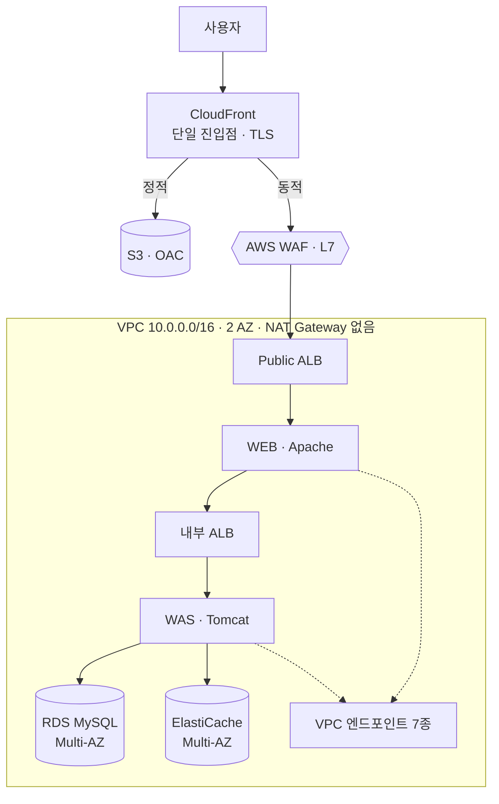

## 프로젝트 요약

| 항목 | 내용 |
|---|---|
| 무엇을 | 동물병원 관리 웹앱(Spring PetClinic)을 운영하기 위한 AWS 3-Tier 인프라 |
| 목표 | 과제 필수 요소(Apache · Tomcat · RDS MySQL · mod_proxy)를 구축하고, AWS Well-Architected 6 Pillars 기준으로 설계 결정을 점검 |
| 팀 구성 | 네트워크/보안(본인) · WEB · WAS · DB · 모니터링 |
| 구축 결과 | VPC 1 · 서브넷 16 (2 AZ) · 커스텀 NACL 8 · **NAT Gateway 0** · VPC 엔드포인트 7 · WAF 규칙 6 |

| 담당 파트 | 설계 | 구축 |
|---|---|---|
| [네트워크](#part-network) | 티어 예약형 대역, NAT 없는 사설 네트워크, 로드밸런서 망 분리 | VPC · 서브넷 16 · 라우팅 · NACL 8 · VPC 엔드포인트 7 |
| [보안](#part-security) | 다층 방어(WAF → NACL → 보안그룹), Bastion 없는 접속, 권한 설계 | 보안그룹 참조 체인, SSM, IAM · MFA, WAF 6규칙, 보안 관측 · 알림 |

## 전체 구조

> 최종 3-Tier 아키텍처 구성도 (팀 작성, 클릭하면 원본 크기로 열립니다).
> 서브넷 라벨의 `/21` · `/22`는 티어 예약 대역이고, 실제 배포한 서브넷은 AZ마다 `/24`입니다.

## 담당 파트 ① 네트워크 {#part-network}

### 설계

**티어 예약형 VPC — 부족한 것은 IP가 아니라 서브넷 개수**

`/16` VPC의 IP는 65,536개로 충분하지만, 서브넷은 VPC당 기본 200개가 한도입니다.
그래서 옥텟 단위로 세 단계를 나눴습니다.

| 단위 | 대역 | 의미 · 적용 |
|---|---|---|
| VPC | `10.x.0.0/16` | VPC 구분 — 다른 VPC와 연결할 때를 대비 |
| 티어 예약 | `10.0.x.0/21` | 티어별 예약 단위 = **NACL 단위** |
| 서브넷 | `10.0.x.0/24` | AZ마다 실제로 배포하는 단위 |

**NACL 규칙은 개별 서브넷이 아니라 티어 예약 대역 단위로 등록**해, 같은 티어에 서브넷을 추가해도 NACL 규칙이 바뀌지 않습니다.

> 발표 자료의 VPC 설계 요약과 티어별 대역표. ELB-PUB · ELB-PRIV만 `/22`로 나눠 NACL을 따로 둡니다.

- **로드밸런서 망 분리** — 공개 · 내부 로드밸런서는 한 구역(8–15)을 `/22` 두 개로 나눠 NACL과 라우팅을 따로 두었습니다. 인터넷용 ALB와 내부 ALB를 네트워크 수준에서 격리하기 위해서입니다.
- **NAT 없는 사설 네트워크** — 프라이빗 라우팅 테이블에서 인터넷 경로(`0.0.0.0/0`)를 없애고, 필요한 AWS 서비스마다 엔드포인트를 두는 Full PrivateLink 구조로 설계했습니다.

| 엔드포인트 | 없으면 생기는 일 |
|---|---|
| ssm · ssmmessages · ec2messages | 서버 접속(Session Manager)과 명령 전달 불가 |
| logs · monitoring | 서비스는 돌지만 로그 · 지표 · 알람이 멈춤 |
| secretsmanager | WAS 기동 시 DB 접속정보를 못 읽어 Tomcat이 뜨지 않음 → 서비스 전체 장애 |
| s3 (Gateway) | Amazon Linux 패키지 설치와 S3 업로드 불가 |

> **트레이드오프** — 실측 결과 VPC 엔드포인트가 프로젝트 비용 1위(13일간 전체의 약 38%)였습니다.
> 이 결정은 비용 절감이 아니라 **보안을 위해 비용을 지불한 선택**이고, 패키지 설치 · OS 패치 부담이 WEB/WAS 파트로 넘어갔습니다.

### 구축

| 구축 항목 | 내용 |
|---|---|
| VPC · 서브넷 | VPC `10.0.0.0/16` 1개, 8개 티어 × 2 AZ(2a · 2c) = 서브넷 16개 |
| 라우팅 | 라우팅 테이블 2개 — PUBLIC-RT(`0.0.0.0/0` → IGW) · PRIVATE-RT(인터넷 경로 없음), IGW 1개, **NAT Gateway 0개** |
| NACL | 티어 예약 대역 단위 커스텀 NACL 8개 |
| VPC 엔드포인트 | Interface 6종(ssm · ssmmessages · ec2messages · monitoring · logs · secretsmanager) + S3 Gateway 1종 |
| 검증 | 구축 후 AWS CLI로 VPC · 서브넷 · NACL · 라우팅 · 엔드포인트를 조회해 설계 문서와 대조 — 모두 일치 |

## 담당 파트 ② 보안 {#part-security}

### 설계

**다층 방어 — 바깥은 넓게, 안쪽은 좁게**

- **WAF(L7)** — 요청 내용을 보고 공격 패턴을 막습니다.
- **NACL(서브넷 경계)** — 티어 사이를 오갈 수 있는 대역과 포트만 엽니다. Stateless라 응답 포트까지 명시합니다.
- **보안그룹(인스턴스)** — IP가 아니라 **바로 앞 계층의 보안그룹**만 허용하고, 경로 계층은 아웃바운드도 다음 계층 포트로만 엽니다. WEB 서버가 침해되더라도 DB 포트로 직접 연결할 수 없습니다.

**Bastion 없는 운영 접속** — SSM Session Manager로 바꿔 **관리용 인바운드 포트 0개**, SSH 키 관리도 없앴습니다. 접속 기록은 CloudTrail(누가 언제 어떤 인스턴스에)과 세션 로그(무엇을 실행했는지) 두 곳에 남깁니다.

**권한 설계** — 팀원 권한은 파트별 IAM 그룹(RBAC)으로 나누고, 서버 접속은 Tier 태그로 범위를 좁히는 방식(ABAC)으로 설계했습니다. MFA를 등록하기 전에는 대부분의 작업을 막습니다.

**WAF — 한도 안에서 고르고, Count로 먼저 관찰** — 관리형 규칙을 모두 켜면 Web ACL 기본 한도(1,500 WCU)를 넘습니다. 규칙 그룹별 WCU를 조회해 앱 특성(Java · DB · Linux)에 맞는 조합만 골랐고, 관리형 규칙은 바로 Block하지 않고 Count로 관찰한 뒤 전환하는 원칙을 세웠습니다.

**보안 관측** — 실시간 감시 · 알림은 CloudWatch, 감사 · 장기 보관은 S3로 나누고, CloudTrail은 두 곳에 동시에 보냅니다.

### 구축

**보안그룹 참조 체인 · NACL**

| 보안그룹 | 인바운드 | 아웃바운드 |
|---|---|---|
| ELB-Pub | 0.0.0.0/0 :80, :443 | → WEB :80 |
| WEB | ← ELB-Pub :80 | → ELB-Priv :8080, VPCE :443 |
| ELB-Priv | ← WEB :8080 | → WAS :8080 |
| WAS | ← ELB-Priv :8080 | → DB :3309, Redis :6379, VPCE :443 |
| DB · Redis · VPCE | 앞 계층 보안그룹만 | 기본값 (말단) |

**WAF Web ACL (사용 WCU 1,305)**

| 우선순위 | 규칙 | 동작 | 의미 |
|---|---|---|---|
| 0 | Origin 검증 | Count | CloudFront가 붙이는 비밀 헤더가 없는 요청 = ALB 직접 호출 탐지 |
| 1 | Common | Block (본문 크기 제한 하위 규칙만 Count) | OWASP 공통 공격 |
| 2 | SQL Injection | Block | SQL 인젝션 |
| 3 | Known Bad Inputs | Block | Log4Shell 등 알려진 익스플로잇 |
| 4 | Linux | Block | LFI · 경로 탐색 |
| 5 | Rate 제한 | Block | IP당 5분 1,000건 초과 차단, 부하테스트 서버 IP는 예외 |

**접속 · 권한 · 보안 관측**

| 구축 항목 | 내용 |
|---|---|
| 운영 접속 | SSM Session Manager(엔드포인트 3종 경유), 세션 로그 기록 |
| IAM | 파트별 IAM 그룹, MFA 강제 정책(`Deny + NotAction`) |
| GuardDuty | 활성화 — 위협 탐지 결과 |
| CloudTrail | 멀티리전 + 로그 파일 무결성 검증, CloudWatch Logs와 S3에 동시 전송 |
| VPC Flow Logs | REJECT 트래픽만 CloudWatch Logs로 |
| WAF · ALB 로그 | WAF → CloudWatch Logs(`aws-waf-logs-`), ALB 접근 로그 → S3 |
| 알림 | CloudWatch Logs → SNS → Slack |

> 중간 점검 시점에는 Flow Logs · GuardDuty가 모두 꺼져 있었습니다. "침해돼도 모르는 상태"를 먼저 없애려고 노력이 적게 드는 순서(GuardDuty → Flow Logs → CloudTrail 점검)로 적용했습니다.

### 문제 해결 — WAF가 사진 업로드를 막았을 때

- **문제** — WAF를 붙이자 반려동물 사진 업로드가 동작하지 않았습니다. 같은 로그에 실제 공격성 요청 차단도 섞여 있었습니다.
- **조사** — WAF 로그 24시간분을 차단 규칙별로 분류해 정상 기능 차단 · 부하테스트 · User-Agent 없는 요청 · SQL 인젝션 시도로 나눴습니다.
- **원인** — 약 80KB 업로드가 관리형 Common 규칙의 본문 크기 제한(8KB)에 걸린 **오탐**이었습니다.
- **조치** — 규칙 그룹 전체가 아니라 해당 **하위 규칙 하나만 Count로 전환**해 기능을 복구했습니다.
- **한 단계 더** — 이렇게 하면 모든 경로의 크기 제한이 함께 풀린다는 문제를 짚고, WAF 라벨을 활용해 **업로드 경로만 예외**로 두는 규칙을 설계했습니다.

| 그 밖의 사례 | 원인 | 조치 |
|---|---|---|
| MFA 강제 정책 때문에 팀원 로그인 불가 | `Deny + NotAction` 목록에 `iam:ChangePassword` 누락 | NotAction 목록에 추가 |
| S3 Gateway 엔드포인트 경유 시 NACL에서 멈춤 | 게이트웨이를 지나도 목적지는 S3 공인 IP, NACL은 프리픽스 리스트를 참조할 수 없음 | NACL 아웃바운드에 S3 대상 443 허용 |
| Flow Logs가 켜져 있는데 로그 0바이트 | IAM 역할 신뢰 정책의 Principal 오류(`ec2` → `vpc-flow-logs`) | 신뢰 정책 수정 |

자세한 내용은 [설계 문서 저장소의 트러블슈팅](https://github.com/swoobuntu/aws-3tier-network-security/blob/main/docs/03-troubleshooting.md)에 정리했습니다.

## 결과와 회고

- **"켜져 있다"와 "동작한다"는 다르다** — Flow Logs가 활성 상태인데도 IAM 신뢰 정책 오류로 로그가 쌓이지 않던 것을 발견했습니다. 이후로는 실제 산출물(로그 · 지표)까지 확인합니다.
- **한계** — CloudFront 우회 호출은 탐지만 하고 차단하지 않았고(다음 단계는 ALB 보안그룹을 CloudFront 관리형 프리픽스 리스트로 제한), AWS Config와 엣지 WAF는 구축하지 못했습니다.
- **다시 한다면** — 콘솔 대신 IaC로 관리하고, 대역 크기는 필요한 IP 수를 산정한 근거와 함께 제시하겠습니다.
